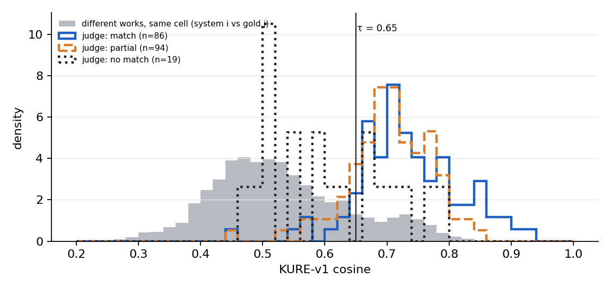
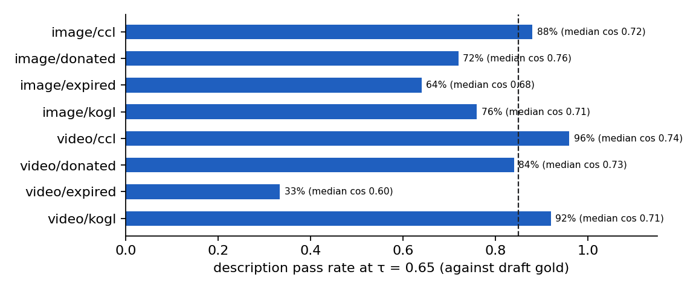

# Pilot 200 and description-threshold (τ) calibration

Started **2026-10-10**, branch `eval-harness-v4`. Companion to `docs/v4/00_progress_and_findings_20261010.md` §10.2.

## 1. Status

| Step | Status |
|---|---|
| 1. Pilot set: 200 works, 25 per cell, all inside the frozen T-002 list | done |
| 2. System run (T-002 pipeline on the 200 works) | done: 200/200 sets ok |
| 3. Scores against the **draft** gold (unverified) | done (§4) |
| 4. Provisional match labels from an independent LLM judge | done (§5) |
| 5. Human stage 1: verify the 200 gold drafts | workbook ready, **waiting for a reviewer** |
| 6. Human stage 2: blind match judgment, system vs verified gold | generated after stage 1 |
| 7. Calibrate τ on human labels | one command after stage 2 |

Everything in §4 and §5 is **provisional**: the gold drafts are not yet verified and the match labels come from a model, not a person. The τ decision waits for steps 5 to 7.

## 2. Why τ needs calibrating

A system description passes when its KURE-v1 cosine with the gold description reaches τ and the two share at least one content word. The working value τ = 0.65 came from two earlier measurements: site captions against shuffled captions of other works (p95 0.516, max 0.571) and matched site captions (median 0.706). Neither compared **our system's output** with **verified gold**, which is what the test scores. The pilot measures exactly that pair, on the same mix of cells as the test.

## 3. Pilot set and run

The original pilot list of 2026-10-08 had 200 works, but 26 of them fell outside the T-002 list frozen on 2026-10-09 and carried older v0.2 drafts. Verifying them would not count toward the final gold, so they were replaced by 26 works drawn from the same cells and sub-sources of the frozen list (seeded draw, `pilot200-v4|20261010|<cell>|<sub-source>`). The dropped ids are in `dataset/pilot200_v4/dropped_from_pilot.csv`.

| Cell | Works | From the original pilot | Replacements | With a contract hint |
|---|---|---|---|---|
| image/ccl | 25 | 24 | 1 | 25 |
| image/donated | 25 | 25 | 0 | 25 |
| image/expired | 25 | 25 | 0 | 25 |
| image/kogl | 25 | 10 | 15 | 21 |
| video/ccl | 25 | 15 | 10 | 25 |
| video/donated | 25 | 25 | 0 | 25 |
| video/expired | 25 | 25 | 0 | 25 |
| video/kogl | 25 | 25 | 0 | 8 |
| **total** | **200** | **174** | **26** | **179** |

Contract hints come from the old-template contracts generated earlier; works without one run with no hint (mostly KOGL videos). No PowerPoint works were drawn.

Run settings: T-002 pipeline, no arbiter on work legs, v4 frame schedule, 6 workers, gold `dataset/test_set_v4/gold23_t002.jsonl` restricted to the 200 predicted sets, τ 0.65 with the content-word check.

| Item | Value |
|---|---|
| Sets ok | 200 / 200 |
| Work-leg time, sum / median per set | 85.9 min / 12.5 s |
| Estimated cost (DashScope unit prices) | ₩221.0 |
| Backends used | image: Gemma 4 31B (OpenRouter) ×100; video: Qwen3-VL-235B (DashScope) ×1; video: Qwen3.5-Omni-Plus (DashScope) ×99 |
| Hashtag source | model: 200 |

Image legs ran on Gemma 4 through OpenRouter, whose spend is not in the ₩ estimate.

## 4. Results against the draft gold (provisional)

| Metric | Value |
|---|---|
| Macro-F1 over the 7 T-002 keys | 76.0 % |
| Micro-F1 | 52.0 % |

| Key | F1 |
|---|---|
| keywords | 28.3 % |
| hashtags | 30.6 % |
| file_format | 100.0 % |
| file_size | 100.0 % |
| resolution | 97.5 % |
| description | 75.9 % |
| file_hash | 100.0 % |

Macro-F1 per cell: image/ccl 79.2 %, image/donated 75.2 %, image/expired 73.6 %, image/kogl 76.7 %, video/ccl 87.5 %, video/donated 79.9 %, video/expired 68.3 %, video/kogl 74.6 %.

### 4.1 Description cosines

199 sets have both a system description and a gold description (gold kinds: generated 197, caption 2).

| Distribution | n | p95 | p99 | max | median |
|---|---|---|---|---|---|
| Same work: system vs its own gold | 199 | — | — | 0.921 | 0.710 |
| Different works, same cell | 4,752 | 0.743 | 0.795 | 0.909 | — |
| Different works, all cells | 39,402 | 0.581 | 0.718 | 0.909 | — |

Same-work cosines: p10 0.612, median 0.710, p90 0.806. Content-word check passed on 88.9 % of same-work pairs.



| τ | Same-work pass rate | Different works accepted (same cell) |
|---|---|---|
| 0.55 | 86.4 % | 28.6 % |
| 0.60 | 82.9 % | 21.3 % |
| 0.65 | 75.9 % | 14.6 % |
| 0.70 | 54.3 % | 9.9 % |
| 0.75 | 29.6 % | 4.0 % |

| Cell | n | Median cosine | Pass at 0.65 | Different-work p99 in this cell |
|---|---|---|---|---|
| image/ccl | 25 | 0.719 | 88.0 % | 0.673 |
| image/donated | 25 | 0.760 | 72.0 % | 0.692 |
| image/expired | 25 | 0.679 | 64.0 % | 0.746 |
| image/kogl | 25 | 0.706 | 76.0 % | 0.619 |
| video/ccl | 25 | 0.739 | 96.0 % | 0.834 |
| video/donated | 25 | 0.733 | 84.0 % | 0.648 |
| video/expired | 24 | 0.598 | 33.3 % | 0.685 |
| video/kogl | 25 | 0.710 | 92.0 % | 0.736 |



| Gold kind | n | Median cosine | Pass at 0.65 |
|---|---|---|---|
| caption | 2 | 0.521 | 0.0 % |
| generated | 197 | 0.710 | 76.6 % |

### 4.2 Hashtags and keywords

Mean set-F1 for hashtags 0.302 (by gold kind: generated 0.348, site 0.107); for keywords 0.267 over the sets with keyword gold (states: na 137, value 63).

Hashtag set-F1 by cell: image/ccl 0.386, image/donated 0.441, image/expired 0.348, image/kogl 0.246, video/ccl 0.291, video/donated 0.421, video/expired 0.133, video/kogl 0.145. Keyword set-F1 by cell: image/ccl 0.316, image/donated 0.26, image/expired 0.167, image/kogl 0.284, video/donated 0.334, video/expired 0.316, video/kogl 0.157.

## 5. Provisional labels from an independent judge

Judge: `deepseek-v4-pro` through DashScope, a model family used neither for the gold drafts (GPT) nor by the system (Qwen, Gemma). It saw the two descriptions in a random A/B order, without the title and without knowing which one was the gold, and answered 일치 (match), 부분일치 (partial) or 불일치 (no match) with the same definitions the human reviewer will use. 40 control pairs of **different** works from the same cell were mixed in. The judge used about 131,000 input and 297,000 output tokens on DashScope; its cost was not metered.

| Label | n | Median cosine | Min | Max |
|---|---|---|---|---|
| 일치 | 86 | 0.728 | 0.449 | 0.921 |
| 부분일치 | 94 | 0.708 | 0.443 | 0.858 |
| 불일치 | 19 | 0.598 | 0.476 | 0.790 |

Controls (different works): 불일치 31, 부분일치 5, 일치 4 of 40.

| Labelling | Best τ by Youden J | Plateau | τ range within 0.02 of best | J at best |
|---|---|---|---|---|
| Strict: only 일치 counts as a match | 0.67 | [0.67, 0.67] | [0.65, 0.73] | 0.198 |
| Lenient: 일치 or 부분일치 | 0.67 | [0.67, 0.67] | [0.64, 0.67] | 0.459 |

At τ = 0.65 against the judge: strict TPR 86.0 %, FPR 68.1 %, κ 0.164; lenient TPR 80.0 %, FPR 36.8 %, κ 0.256.


The judge's first attempt used Claude Sonnet 5.5 through OpenRouter. It stopped after 28 labels because the OpenRouter credit ran out (§6, finding 7), and those labels were set aside (`judge_claude_partial.jsonl`) so that a single judge labels every pair.

## 6. Findings

1. **The τ value is not the main problem.** Against the judge's labels the best τ is 0.67 under both labellings, and 0.65 lies inside the near-best range. What is weak is the separation itself. The best Youden J is 0.20 strict and 0.46 lenient. At 0.65, 7 of 19 pairs the judge called 불일치 still pass, and 12 of 86 pairs it called 일치 fail.
2. **Descriptions written in the same style look alike to the embedding.** Different works in the same cell reach a cosine of 0.743 at p95 and 0.795 at p99, and 14.6 % of such pairs would pass at τ 0.65. The earlier calibration, with site captions across all cells, put p95 at 0.516. The worst cell is video/ccl, where every 수어 clip shows the same signer on the same green background. Episodes of one film serial behave the same way. The judge cannot separate these works from text either: 4 of its 40 control pairs were labelled 일치 and 5 부분일치, all 수어 clips or similar works from the same series.
3. **The system and the gold follow different writing rules, and that costs more than τ.** On 수어 clips the system does not name the signed word, although the contract hint gives the title that contains it. The VLM prompt tells it to describe the screen content only, while guideline v0.3 rule 6-1 names the word. On old films, video/expired passes only 33 %: the system writes plot summaries from outside knowledge, such as a princess offered as a sacrifice on the island of Lemuria, while the gold describes only the visible frames. The judge labelled only 3 of the 24 video/expired pairs 일치.
4. **Hashtags and keywords decide the pass.** Macro-F1 is 76.0 % although the four file keys are at or near 1.0. The seven per-key F1 values sum to 5.32, and 85 % needs 5.95. With description at 0.85, hashtags and keywords would each need about 0.55; today they are 0.31 and 0.28. Exact or containment set matching gives no credit for near-synonyms such as #전통종이 against #한지. Keyword gold exists for only 63 of the 200 sets; the rest are collection tags marked N/A.
5. **Resolution gold disagrees with the file for 60 of the 2,000 T-002 images**, 5 of them in the pilot. For 공유마당 images the gold is the value posted on the detail page, but the downloaded file is slightly cropped, or stored with width and height swapped. The system measures the file, so it is right and the gold is wrong. Counts: image/donated 44, image/expired 12, image/ccl 4, image/kogl 0.
6. **The content-word check matters.** 22 same-work pairs share no content word with their gold. 12 of them have a cosine of 0.65 or more, so the check alone rejects them.
7. **OpenRouter credit is almost exhausted.** The 100 image legs of this run went to Gemma 4 through OpenRouter, and the account can now afford only about 1,000 tokens per request. Until credit is added, image legs fall back to the next backend in the chain. That fallback changes which model the test measures.

## 7. What to do next (proposals, not yet decided)

| # | Proposal | Why | Who decides |
|---|---|---|---|
| 1 | Keep τ = 0.65 until the human labels are in | The provisional best, 0.67, is within the noise of the judge labels | — |
| 2 | Align the VLM prompts with guideline v0.3: name the 수어 word from the title, no plot or outside knowledge, the same hashtag rules | Finding 3 is the largest controllable loss | user |
| 3 | Check any prompt change on works **outside** the test lists, for example the 26 works dropped from the pilot and other non-test works | All 200 pilot works belong to the frozen T-002 set; tuning on them would overfit the test | user |
| 4 | Rebuild the resolution gold from the measured file size and fix the rotation rule (stored pixels, or pixels after the rotation flag) | Finding 5 | user |
| 5 | Ask 장세영 whether hashtags and keywords may be matched semantically, per tag, instead of by exact or containment match | Finding 4; the rule is part of the procedure | user, 장세영 |
| 6 | Add OpenRouter credit, or decide which image model the test measures | Finding 7 | user |

## 8. Finishing the calibration (human steps)

1. **Stage 1, gold verification, about 5 hours.** Open `dataset/pilot200_v4/review_1_gold.xlsx`, sheet `review`. For each row, open the work file or the frames folder, then set `verdict` to ACCEPT, EDIT or REJECT. For EDIT, write the corrected text in `final_text` and the corrected hashtags in `final_hashtags`. Instructions are in the `안내` sheet. This workbook shows no system output, so the system's wording cannot leak into the gold. It replaces the older `review_verification_pilot_200.xlsx`.
2. **Import the verified gold:**
```bash
venv/bin/python api/module/dataset_builder/generate_descriptions.py --out dataset/gold_descriptions/t002_full --import-review dataset/pilot200_v4/review_1_gold.xlsx
```
The import writes `gold_descriptions.jsonl` from the given workbook only. When the full 4,000-work review is imported later, merge these 200 verdicts into it first.
3. **Stage 2, blind match judgment, about 2 hours:**
```bash
venv/bin/python -m api.module.evaluation.v4.pilot_tau match --run dataset/pilot200_v4/run1 --ids dataset/pilot200_v4/pilot_ids.csv --stage1 dataset/pilot200_v4/review_1_gold.xlsx --out dataset/pilot200_v4/review_2_match.xlsx
```
Each row shows two descriptions as A and B in random order, and the reviewer marks 일치, 부분일치 or 불일치. Which one is the gold is stored only in `review_2_match.mapping.json`.
4. **Calibrate:**
```bash
venv/bin/python -m api.module.evaluation.v4.pilot_tau calibrate --run dataset/pilot200_v4/run1 --ids dataset/pilot200_v4/pilot_ids.csv --stage1 dataset/pilot200_v4/review_1_gold.xlsx --stage2 dataset/pilot200_v4/review_2_match.xlsx --judge dataset/pilot200_v4/analysis/judge.jsonl --out dataset/pilot200_v4/calibration
```
This recomputes the cosines against the verified gold, picks τ under the strict and lenient labellings, and reports the judge's agreement with the human labels.

All four steps were dry-run on a scratch copy with random answers: 200 verdicts imported, 191 pairs generated after 9 rejections, and the calibration completed.

## 9. Files

| What | Where |
|---|---|
| Pilot list (200), dropped ids (26) | `dataset/pilot200_v4/pilot_ids.csv`, `dropped_from_pilot.csv` |
| Manifest and run outputs | `dataset/pilot200_v4/manifest.jsonl`, `run1/` (`test_predictions/`, `per_set.jsonl`, `test_metrics.json`, `report.md`, `test.log`) |
| Analysis | `dataset/pilot200_v4/analysis/` (`analysis.json`, `tau_sweep.csv`, `per_set_description.csv`, `per_set_judge.csv`, `per_set_hashtags.csv`, `per_set_keywords.csv`, `judge.jsonl`, `judge_run.json`, charts) |
| Human workbooks | `dataset/pilot200_v4/review_1_gold.xlsx`; stage 2 is generated after stage 1 |
| Tool and tests | `api/module/evaluation/v4/pilot_tau.py`, `api/module/evaluation/v4/tests/test_pilot_tau.py` (7 tests) |
| Charts in this document | `docs/v4/pilot200_assets/` |

Everything under `dataset/` is gitignored.
